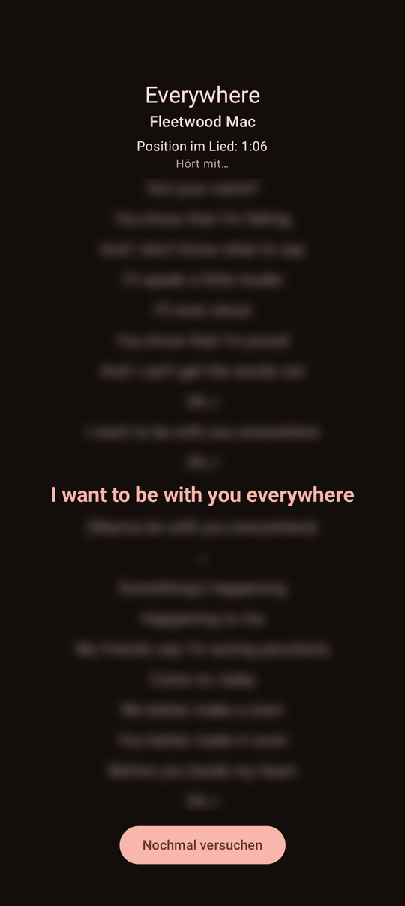

# Earacle

🔮👂 **The oracle for your ears – recognizes songs from the radio and shows the lyrics live, perfectly in sync.**

Earacle (ear + oracle) is a personal Android app. It listens through the microphone to music playing nearby (for
example a radio), recognizes the song and shows its lyrics line by line, in sync with the music.

The interface is in German and English and follows the phone's language.

  
  &nbsp;
  

Start screen and a recognized song (German interface). The other lyric lines are blurred
here because the lyrics are copyrighted; in the app they are readable.

## Status

**Early stage (version 0.5.0).** Earacle recognizes a song from the microphone, shows its title, artist and
position, and shows the synced lyrics with the current line highlighted. It keeps listening along and follows
song changes, but only while the app is open; the screen stays on meanwhile. Listening in the background (with
the screen off) is not built yet; see "Planned".

## Features

- Recognizes the song that is playing with one tap on "Recognize song": title, artist and position in the song
- Shows synced lyrics from LRCLIB with the current line highlighted and centred; scroll freely to read ahead,
  and the sync button jumps back to the current line
- Tap the lyric line that is being sung to fix the timing; `−0.5 s` / `+0.5 s` fine-tune it, tapping the shown
  value resets it. The correction stays while the app listens along and resets for a new song
- Three dots count down in a long pause (before the first line, in an instrumental part, in a long gap): they go
  out one by one in the last 3 seconds, and the next line is shown a little brighter
- The line being sung fills up from left to right in the highlight colour, at the pace it is sung (estimated
  from its length); wrapped lines fill one visual line after the other
- Shows plain lyrics, or a clear message, when no synced lyrics exist
- Listens along while the app is open: follows song changes, corrects drift, skips silence and stops after 4
  recordings in a row without a match
- Interface in German and English

## Planned

- Listening with the screen off, in the background, through a foreground service
- Karaoke features for singing along: word timing where the lyrics have it, backing vocals shown
  smaller, and a stage mode with very large text (see [the plan](docs/karaoke-plan.md))
- Possible fallback recognition with Olaf against your own music library, in case the unofficial Shazam API
  stops working

## How it works

1. **Listening:** while the app is visible, it records 12 seconds of audio with `AudioRecord`.
2. **Recognition:** a fingerprint of the recording (ported from SongRec) is sent to the unofficial
   (reverse-engineered) Shazam API, as used by open-source projects such as SongRec, ShazamIO and
   MusicRecognizer (Audile). Shazam's offset is the position in the song at the start of the sample, so the
   current position is the offset plus the time since the recording started.
3. **Lyrics:** [LRCLIB](https://lrclib.net), which is free and needs no API key, is searched with title and
   artist. Earacle picks the matching version: no live or remix version unless the song is one, and synced
   lyrics are preferred over plain ones.
4. **Listening along:** after a first match, the app records again after a pause that grows while the same song
   keeps being confirmed (about 27 seconds, then 1 minute, then 2 minutes between recordings). The next
   recording is brought forward to the song's end, so a song change is noticed. Silence is not sent to
   Shazam. After 4 misses in a row it stops, and on a rate limit it waits 60 seconds.

**Please note:** the unofficial Shazam API is not endorsed by Apple or Shazam and may break at any time. Earacle
is a personal project and is not published in any store.

Built with Kotlin and Jetpack Compose.

## Install

Requirements: Android 10 or newer and an internet connection. The app asks for microphone access on first
use.

Download the APK from the latest release:

1. On your phone, open the repository's **Releases** page on GitHub and download `earacle-vX.Y.Z.apk` from
   the latest release.
2. Open the file and install it (allow installing from this source if Android asks), or install it from a
   computer with `adb install -r earacle-vX.Y.Z.apk`.

Releases are signed with a fixed key kept in the repository's GitHub secrets `EARACLE_KEYSTORE_BASE64` and
`EARACLE_KEYSTORE_PASSWORD`, so a newer version installs over the old one and keeps the app's data. Keep a
backup of the keystore and its password outside GitHub (GitHub secrets cannot be read back).

To try a branch before it is merged: **Actions → Build → Run workflow**, pick the branch, then download
**earacle-test-apk** under "Artifacts" on the run's page (kept for one day; a zip file with the `.apk` inside).

## Release

1. Raise `versionName` and `versionCode` in `app/build.gradle.kts` in a pull request, with the release notes in
   its description, and merge it.
2. **Actions → Release → Run workflow**, enter the version with a `v` (for example `v0.4.0`), **Run workflow**.

The workflow checks the version, builds and signs the APK, creates the tag and the GitHub Release and attaches
the APK.

## Development

- Earacle is built together with AI assistants. Instructions for AI tools are in [AGENTS.md](AGENTS.md)
  (for Claude: [CLAUDE.md](CLAUDE.md)).
- Kotlin + Jetpack Compose, one module (`app`). Versions are kept in `gradle/libs.versions.toml`.
- Build locally with Android Studio or `./gradlew assembleDebug` (JDK 17 or newer, Android SDK).
- GitHub Actions runs the unit tests and checks that the app compiles on every pull request
  (`.github/workflows/build.yml`), builds releases (`.github/workflows/release.yml`) and scans every push and
  pull request for leaked secrets with gitleaks (`.github/workflows/gitleaks.yml`).
- Unit tests (JUnit 4) in `app/src/test` cover the fingerprint, the Shazam request and answer handling, the
  position maths, the listening-along timing (`SongTracking`), LRC parsing, the LRCLIB version choice and the
  displayed title. Run them with `./gradlew testDebugUnitTest`; CI runs them on every pull request.
  Microphone, real recognition and the screen can only be checked on a real phone.

## Credits

- [LRCLIB](https://lrclib.net) for synced lyrics
- SongRec, ShazamIO and MusicRecognizer (Audile) as references for the Shazam-based recognition
- The audio fingerprinting (`app/src/main/java/io/github/drnerdlove/earacle/recognition`) is ported from
  [SongRec](https://github.com/marin-m/SongRec) by marin-m (GPL-3.0-or-later), used under this project's AGPL-3.0

## License

GNU AGPL-3.0, see [LICENSE](LICENSE).
